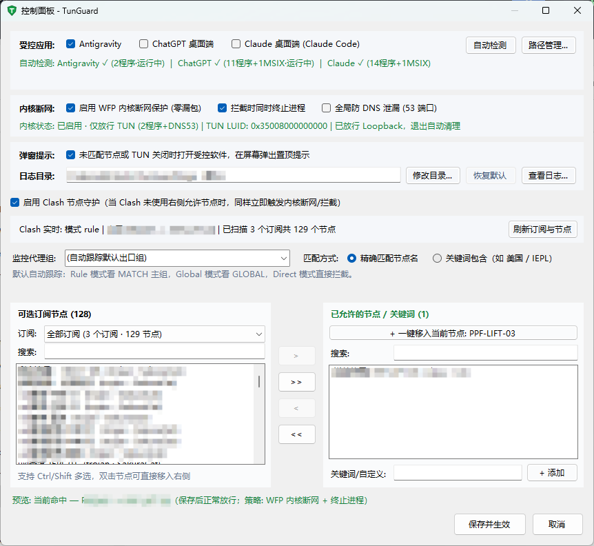
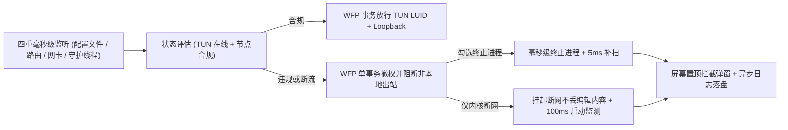

# TunGuard

[](https://github.com/wdnmd123-zzz/TunGuard)
[](https://github.com/wdnmd123-zzz/TunGuard)
[](https://github.com/wdnmd123-zzz/TunGuard)
[](https://github.com/wdnmd123-zzz/TunGuard/releases)

轻量级 Windows (x64) 系统托盘守护工具，实时监控 **Clash Verge Rev** 的 **TUN 模式状态** 与可选的 **当前生效代理节点**，并结合 **Windows Filtering Platform (WFP) 内核级 Kill Switch**、毫秒级进程守护与屏幕置顶拦截提示，保护已勾选的桌面端 AI 应用（**Antigravity**、**ChatGPT 桌面端 / Codex**、**Claude 桌面端 / Claude Code**），从内核层到应用层防止断流裸连或走错节点引发账号风控。

[核心亮点](#核心亮点) · [界面预览](#界面预览) · [工作原理](#工作原理与防护模式) · [受控应用与条件](#受控应用与拦截触发条件) · [核心特性](#核心特性) · [快速开始](#快速开始) · [配置参考](#节点判定规则与配置说明) · [FAQ](#常见问题faq)

---

## 核心亮点

- **零外部依赖 · 单文件 ~238 KB**：纯 C# + Win32 P/Invoke（`iphlpapi.dll` / `fwpuclnt.dll` / `userenv.dll`），直接利用 Windows 内置 `.NET Framework 4.x`（`csc.exe`）编译为单个原生 x64 可执行文件。
- **内核级零漏包兜底（WFP）**：在 Windows 内核 `ALE_AUTH_CONNECT`（IPv4 + IPv6）层常驻受控应用出站规则——仅放行 TUN 虚拟网卡与 Loopback，TUN 掉线瞬间**零时间窗**丢弃物理网卡直连流量；支持**纯内核断网保留进程**或**内核断网 + 强杀双重兜底**。
- **免配置直连 Clash 内核**：自动探测并复用 Clash Verge 的 Windows Named Pipe（`\\.\pipe\verge-mihomo-*`），**无需开启外部 HTTP 控制器**即可读取实时节点链路（支持自动回退 TCP 外部控制器）。
- **极低后台开销**：事件驱动 + HTTP/1.1 Keep-Alive 单组定向查询 + 零反射轻量 JSON 提取，单次节点巡检 `< 0.5 ms`。
- **开箱即用 · 完整可视化管理与一键更新**：提供受控应用自动识别与自定义路径管理、全订阅节点左右穿梭框、屏幕置顶拦截提醒卡片、异步分级日志查看器，以及内置 GitHub Releases 检查更新与 SHA-256 校验一键原地升级。

---

## 界面预览

### 控制面板

<p align="center">
  
</p>

> 控制面板集中提供受控应用自动检测与路径管理、WFP 内核策略开关、置顶弹窗与日志目录配置、按订阅筛选的节点穿梭框与保存前实时命中预览，以及底部的 GitHub 仓库入口、版本检测与一键更新。

### 屏幕置顶拦截提示

<p align="center">
  
</p>

> 当 TUN 未开启或出口节点未命中允许列表且受控软件触发拦截时，屏幕上方立即弹出置顶提醒卡片，直观展示拦截原因、当前出口链路、允许节点列表与执行动作，并支持一键打开控制面板或查看日志。

---

## 工作原理与防护模式



TunGuard 支持三种防护执行模式，可在控制面板随时切换：

| 防护模式 | 触发配置 | 行为与适用场景 |
| --- | --- | --- |
| **WFP 内核断网 + 终止进程（默认）** | 管理员权限 + 勾选 `启用 WFP 内核断网保护` 与 `拦截时同时终止进程` | 最高安全级别：WFP 内核零窗口阻断 + `TerminateProcess` 强杀与 `5 ms` 子进程补扫（同时封堵未绑定源 IP 的 UDP/QUIC 残留）+ `30 ms` 防重启守卫 |
| **纯 WFP 内核无损断网** | 管理员权限 + 取消勾选 `拦截时同时终止进程` | 无损编辑体验：断流或切错节点时仅在内核层切断出站连接，**保留应用进程与未保存编辑内容**，恢复合规后自动恢复联网；期间打开受控应用会触发 `100 ms` 监测并弹出置顶提示 |
| **应用层进程守护（自动降级）** | 取消启用 WFP 或以非管理员权限运行 | 当 WFP 不可用时自动强制回退为进程强杀模式（即使之前取消了「拦截时同时终止进程」），避免出现保护真空 |

---

## 受控应用与拦截触发条件

### 1. 受控应用支持（可在控制面板或托盘菜单独立勾选，默认全选）

| 受控应用 | 自动识别与匹配规则（同时作用于 WFP 内核规则与进程守护） |
| --- | --- |
| **Antigravity** | `Antigravity.exe` 及位于 `\antigravity\` 或受信任安装根目录下的 `language_server*.exe` |
| **ChatGPT 桌面端 (Codex)** | `ChatGPT.exe`，`WindowsApps\OpenAI*` / `WindowsApps\ChatGPT*` / `\ChatGPT\` / `\OpenAI\ChatGPT\` / `\OpenAI\Codex\` 下的 `ChatGPT*.exe`、`Codex*.exe`、`OpenAI*.exe`，以及对应 MSIX/Store 包（`ALE_APP_ID` + `ALE_PACKAGE_ID` 双重保护） |
| **Claude 桌面端 (Claude Code)** | `ClaudeDesktop.exe` / `Claude Desktop.exe` / `ClaudeCode.exe` / `Claude Code.exe`，以及 WindowsApps / `AnthropicClaude` / `Claude` / `Claude-3p` / `Claude-zh*` / `Claude Code` 等目录下的 `Claude*.exe`（含 `claude.exe`）、`Anthropic*.exe`、`cowork-svc.exe` 与对应 MSIX 包（不影响 VS Code 插件或无关目录进程） |

> 支持通过控制面板 **「路径管理...」** 随时查看本机已生效目标，或手动添加便携版目录 / 自定义 `.exe`（与自动识别规则同步生效）。

### 2. 放行与拦截判定条件

当 **实时监控** 开启时，以下任意条件不满足都会立即触发拦截（WFP 内核断网 / 按策略终止进程）：

| 检查维度 | 放行条件 | 触发拦截的场景 |
| --- | --- | --- |
| **TUN 模式**（始终启用） | `verge.yaml` 允许 TUN + 虚拟网卡在线 + IPv4 默认路由有效 | 关闭 TUN 开关、退出 Clash Verge、`verge-mihomo` 崩溃、虚拟网卡下线或默认路由断开 |
| **Clash 节点**（可选启用，默认关闭） | 实际出口节点命中允许列表中的任意一项 | 切换到未授权节点、切到其他订阅、`Direct` 直连模式、`Global` 指向非允许节点、指定代理组不存在或控制接口不可达（Fail-Closed） |

---

## 核心特性

### 1. WFP 内核级 Kill Switch（防漏包 + 防砖机）

在独立的 TunGuard WFP Provider 与 Sublayer（`FWPM_LAYER_ALE_AUTH_CONNECT_V4` & `V6`）内，通过单事务原子维护五级优先级规则（数值越大越先命中）：

| 权重 | 生效时机 | 匹配条件 | 动作 | 作用 |
| --- | --- | --- | --- | --- |
| `14` | 仅拦截态 | 受控应用 + Loopback 访问 Clash 本地代理端口（`mixed-port` / `port` / `socks-port`） | `BLOCK` | 防止关闭 TUN 后应用经系统代理端口旁路绕过拦截 |
| `12` | 常驻 | 受控应用 + `IS_LOOPBACK`（`127.0.0.1` / `::1`） | `PERMIT` | 保障 `Antigravity.exe ↔ language_server` 及 Electron / MCP 本地 IPC 通信 |
| `11` | 仅开启防 DNS 泄漏时 | `verge-mihomo*.exe` 访问远程端口 `53`（及 TUN / Loopback 放行） | `PERMIT` | 启用全局 53 端口拦截时豁免 Mihomo 上游域名解析 |
| `10` | 仅安全态且 TUN 在线 | 受控应用 + `IP_LOCAL_INTERFACE == tunLuid`（取自 `MIB_IF_ROW2`） | `PERMIT` | TUN 掉线瞬间自动失配；切错节点时单事务撤除触发 ALE Reauthorization 秒断网；网卡重建换 LUID 时单事务先加后删零断流 |
| `1` | 常驻兜底 | 受控应用所有连接（及开启 DNS 保护时非 TUN 的 `53` 端口） | `BLOCK` | 阻断受控应用所有非 Loopback、非 TUN 的 IPv4/IPv6 出站直连 |

- **三层路径解析 + MSIX 升级免疫**：启动扫描 MSIX 注册表（`AppModel` / `AppxAllUserStore`）、`Uninstall` 注册表、常见安装目录（5 层递归）与桌面/开始菜单 `.lnk` 快捷方式；运行中每 `2 s` 热发现新进程、拦截时即时补录路径（消除新版首次启动空窗），并自动清理失效缓存。
- **可选全局防 DNS 泄漏（53 端口）**：勾选后阻断系统 `dnscache`（`svchost.exe`）等所有进程经非 TUN 网卡发出的 UDP/TCP 53 端口查询（自动豁免 Loopback、TUN 与 Mihomo 内核；建议仅在 Clash TUN 开启 DNS 劫持时启用）。
- **防砖机动态会话**：采用 `FWPM_SESSION_FLAG_DYNAMIC` 动态会话，无论正常退出、异常崩溃还是暂停监控，Windows Base Filtering Engine（BFE）都会自动清空全部规则，绝不锁死网络。

### 2. 四重联动毫秒级检测 & Mihomo 直连

- **配置文件实时监听（`FileSystemWatcher`）**：监听 `%APPDATA%\io.github.clash-verge-rev.clash-verge-rev\` 下的 `verge.yaml`、`clash-verge.yaml`、`config.yaml` 与 `profiles.yaml`，配置变动 `< 1 ms` 唤醒复核。
- **内核路由回调（`NotifyRouteChange2`）**：即时捕获 TUN 虚拟网卡 IPv4 默认路由移除事件。
- **内核网卡回调（`NotifyIpInterfaceChange`）**：即时捕获虚拟网卡下线并直读 `MIB_IF_ROW2` 偏移 `0` 的 `InterfaceLuid` 同步给 WFP。
- **自适应守护线程**：安全态 `250 ms` 低功耗巡检；纯 WFP 拦截态 `100 ms` 监测新启动受控进程；强杀拦截态 `30 ms` 高频守卫（零分配 PID 快照比对）；配置热更新每 `1 s` 自动重载。
- **Mihomo Keep-Alive 定向巡检**：通过 `WaitNamedPipeW` 优先直连 `\\.\pipe\verge-mihomo-*`（自动回退 TCP `external-controller`），复用 HTTP/1.1 持久连接仅查询目标代理组 `GET /proxies/{group}`，大订阅亦保持 `O(1)` 恒定开销。

### 3. 控制面板、应用路径管理与全订阅穿梭框

双击托盘图标或右键 **「打开控制面板...」** 打开统一管理界面：

- **受控应用自动检测与路径管理**：打开控制面板自动扫描本机安装目录、MSIX 包、注册表、快捷方式与运行中进程，实时显示 **Antigravity / ChatGPT / Claude** 状态；支持一键 **「自动检测」** 与 **「路径管理...」**（查看只读已生效目标、手动添加绿色版目录或自定义 `.exe`）。
- **全订阅自动扫描**：解析 `profiles.yaml` 与 `profiles\*.yaml`（兼容流式与块式 YAML）并合并 Mihomo 实时节点，内置 `(mtime, size)` 文件缓存，二次打开 `< 1 ms`。
- **左右穿梭框节点管理**：左侧支持按订阅筛选 + `80 ms` 防抖搜索、`Ctrl` / `Shift` 多选与双击穿梭；支持 `>` / `>>` / `<` / `<<` 批量操作、**一键移入当前正在使用的节点**及手动添加关键词；右侧至少移入 1 项后方可启用 **「启用 Clash 节点守护」**（移入首项时自动勾选启用，清空右侧列表时自动取消并禁用复选框，避免空列表误触发全量拦截）；保存前实时预览命中结果，若保存后会立即触发拦截则弹出二次确认。

### 4. 屏幕置顶拦截弹窗、异步日志系统 & 系统托盘

- **屏幕置顶拦截弹窗（`popupOnBlock`，默认开启）**：在 TUN 未开启或节点不匹配状态下，一旦打开受控应用或运行中被拦截，屏幕上方即刻弹出非阻塞置顶提醒卡片（支持拖拽），清晰展示**拦截原因、当前出口链路、允许节点与执行动作**，并直达控制面板与日志查看器；卡片保持常驻直至手动点击 **「确认」** / 按 `Esc` 关闭，或在网络状态恢复合规后自动收起，确保重要拦截提示不会被错过。
- **异步日志系统 & 日志查看器**：独立后台线程无阻塞异步落盘，按天切分 `TunGuard-yyyy-MM-dd.log`（UTF-8 无 BOM）。右键托盘或控制面板点击 **「查看日志...」** 可按日期切换日志、按 `INFO / WARN / ERROR` 分级着色筛选、关键词搜索、自动滚动跟踪、复制与清空；支持自定义日志目录（写权限预检、一键恢复默认、打开目录，以及自动询问迁移历史日志）。
- **动态盾牌托盘图标**：

| 托盘图标颜色 | 当前状态 | 托盘状态与悬浮提示说明 |
| --- | --- | --- |
| **绿色** | 守护正常 | TUN 已开启（若启用节点守护则当前节点命中允许列表），启用 WFP 时悬浮提示带 `[WFP]` 标识 |
| **红色** | 已拦截 | TUN 未开启或当前节点不匹配，已通过 WFP 内核阻断出站（及按配置终止受控进程） |
| **灰色** | 已暂停 | 已临时暂停监控与拦截，自动清空 WFP 内核规则并跳过节点轮询 |

### 5. 内置版本检测与一键安全自更新

控制面板底部栏内置 GitHub 图标直达仓库主页、当前版本展示与在线更新能力：

- **双通道版本检测**：打开控制面板时后台静默检测更新（内置 `10 min` 缓存），也可点击 **「检查更新」** 强制刷新；优先请求 GitHub Releases API，遇到接口限流（HTTP `403 / 429`）或异常时自动回退至 `releases/latest` 重定向 `HEAD` 解析。
- **完整校验链与可取消下载**：发现新版本后展示绿色 **「一键更新 vX.Y.Z」** 按钮与变更摘要；下载前预检目录写权限、实时反馈进度并支持中途取消，下载完成后依次通过**文件体积核对 → PE 头 (`MZ`) 校验 → `SHA256SUMS.txt` SHA-256 哈希验证**。
- **原位热替换与失败自动回滚**：将运行中的旧版备份为 `.old` 后把已校验的新版本移入原路径（替换失败自动回滚旧版，绝不丢失程序文件），随后干净释放单实例互斥锁与 WFP 动态会话并自动重启新版本，启动后后台异步清理残留的 `.old*` / `.new*` 临时文件；若因网络或权限受限更新失败，可一键打开 GitHub Releases 页面手动下载。

### 6. 单实例保护 & 原生开机自启

- **单实例互斥锁**：重复启动不会多开后台进程，而是唤醒已有实例通过托盘气泡展示当前守护与 WFP 内核状态。
- **原生 Task Scheduler 2.0 COM 自启**：右键勾选 **「开机自动启动」**，直接通过 `Schedule.Service` COM API 注册计划任务 `ClashTunGuard`（`<RunLevel>HighestAvailable</RunLevel>` 自动提权激活 WFP、支持电池供电、无 72 小时超时限制、不拉起隐藏 `schtasks.exe`）。

---

## 快速开始

### 环境要求

- **系统**：Windows 10 / 11 (x64)
- **运行时**：Windows 内置 `.NET Framework 4.x`（本地编译需 `C:\Windows\Microsoft.NET\Framework64\v4.0.30319\csc.exe`）
- **代理客户端**：Clash Verge Rev（已开启或准备使用 TUN 模式）
- **权限**：推荐管理员权限（用于启用 WFP 内核断网与注册高权限计划任务；标准权限下会自动降级为应用层强杀守护）

### 1. 获取程序（下载 Release 或本地编译）

- **方式一（推荐）**：直接前往 [GitHub Releases](https://github.com/wdnmd123-zzz/TunGuard/releases) 下载最新构建的 `TunGuard.exe`（或 `TunGuard-vX.Y.Z-win-x64.zip`）与 `SHA256SUMS.txt`；每次推送源码更新到 `main` 分支都会由 GitHub Actions 自动构建并发布新版本。后续升级可直接在控制面板左下角点击 **「检查更新」 → 「一键更新」** 自动完成校验替换与重启。
- **方式二（本地编译）**：在项目根目录运行：

```powershell
powershell -NoProfile -ExecutionPolicy Bypass -File .\build.ps1
```

脚本会自动生成盾牌图标 `TunGuard.ico` 并编译出独立的 `TunGuard.exe`。

### 2. 启动与开机自启

1. **以管理员权限运行** `TunGuard.exe`（清单已声明 `highestAvailable`），程序将以 `High` 优先级静默启动并在系统托盘显示盾牌图标。
2. 右键托盘图标勾选 **「开机自动启动」** 即可完成高权限开机自启注册。
3. 如需桌面快捷方式，可右键 `TunGuard.exe` → **发送到 → 桌面快捷方式**。

### 3. 控制面板配置指南

1. **双击托盘图标**（或右键 → **「打开控制面板...」**）打开控制面板。
2. 确认顶部 **受控应用** 勾选范围（默认 **Antigravity / ChatGPT 桌面端 / Claude 桌面端** 均已勾选；如有便携版或特殊安装位置可点击 **「路径管理...」** 添加）。
3. 在 **内核断网** 栏确认 **启用 WFP 内核断网保护 (零漏包)** 已勾选，按需选择：
   - 保持勾选 **拦截时同时终止进程**（默认，内核断网 + 强杀双重保险），或取消勾选体验“仅断网保留编辑内容”；
   - 若 Clash TUN 已开启 DNS 劫持且需封堵系统 `dnscache` DNS 泄漏，可勾选 **全局防 DNS 泄漏 (53 端口)**。
4. 按需开关 **弹窗提示** 与自定义 **日志目录**。
5. 如需限制出口节点：先在左侧筛选节点并移入右侧允许列表（或直接点击 **一键移入当前节点**；移入首项后 **启用 Clash 节点守护** 将自动解锁并勾选），选择 **精确匹配节点名** 或 **关键词包含**，最后点击 **保存并生效**。

---

## 节点判定规则与配置说明

启用节点守护后，TunGuard 会递归展开嵌套代理组（如 `PROXY -> 自动选择 -> 节点A`，内置防循环引用），并以**最终实际出口节点**比对允许列表：

| Clash 模式 | 监控代理组设置 | 实际校验链路 |
| --- | --- | --- |
| `Rule` | `(自动跟踪默认出口组)`（默认） | 跟踪 `MATCH` 默认规则指向的出口组并递归至最终节点 |
| `Rule` | 手动指定代理组（如 `PROXY` / `AI`） | 校验所选代理组并递归至最终节点（切订阅导致该组不存在时触发拦截） |
| `Global` | 任意 | 强制跟踪 `GLOBAL` 并递归至最终节点（防止切换 Global 模式绕过规则组） |
| `Direct` | 任意 | 直接判定为未命中并触发拦截 |

<details>
<summary><b><code>TunGuard.config.json</code> 配置字段说明（点击展开，支持 1 秒内热重载）</b></summary>

配置自动保存在程序同目录 `TunGuard.config.json`（已加入 `.gitignore`），手动修改后会在 1 秒内自动生效：

| 字段 | 默认值 | 说明 |
| --- | --- | --- |
| `enabled` | `false` | 是否启用 Clash 节点守护（关闭时仅监控 TUN 状态） |
| `proxyGroup` | `""` | 监控代理组名称；留空表示自动跟踪 `MATCH` 默认出口组 |
| `matchMode` | `"exact"` | 节点匹配模式：`exact`（精确匹配，忽略大小写）或 `contains`（关键词包含） |
| `allowedNodes` | `[]` | 允许的出口节点名或关键词列表 |
| `guardedApps` | `{"antigravity": true, "chatgpt": true, "claude": true}` | 三个受控应用的独立守护开关 |
| `wfpEnabled` | `true` | 是否启用 WFP 内核级断网保护 |
| `wfpKillOnBlock` | `true` | 拦截时是否同时终止受控应用进程（`false` 为纯内核无损断网模式） |
| `wfpBlockNonTunDns` | `false` | 是否开启全局非 TUN 53 端口防 DNS 泄漏 |
| `popupOnBlock` | `true` | 拦截或拦截态打开受控软件时是否显示屏幕置顶提示卡片 |
| `logDirectory` | `""` | 自定义日志存放目录；留空时默认使用程序同目录 `logs\` |
| `customAppPaths` | `{}`（可选） | 用户在「路径管理...」中添加的自定义目录或 `.exe` 路径映射 |
| `discoveredAppPaths` | `{}`（可选） | 运行时自动发现的受控程序路径缓存（失效路径会自动清理） |

</details>

---

## 常见问题（FAQ）

<details>
<summary><b>如何验证 WFP 内核规则确实生效，且退出后零残留？</b></summary>

在管理员 PowerShell 中运行以下命令导出当前系统 WFP 过滤器并检索 TunGuard 规则：

```powershell
netsh wfp show filters file=wfp_filters.xml
Select-String -Path .\wfp_filters.xml -Pattern "TunGuard WFP Kill Switch"
```

- TunGuard 正常运行且处于监控状态时，可检索到对应的 Provider、Sublayer 与 Filter 记录；
- 暂停监控或退出 `TunGuard.exe` 后再次运行上述命令，结果应为空（`DYNAMIC` 会话由 Windows BFE 自动清空，绝不锁死网络）。

</details>

<details>
<summary><b>如何做到“断网不丢编辑内容”？和默认强杀模式有什么区别？</b></summary>

在控制面板中保持勾选 **启用 WFP 内核断网保护 (零漏包)**，并**取消勾选「拦截时同时终止进程」**即可进入纯内核无损断网模式：
- TUN 掉线或切错节点时，WFP 会在内核层直接阻断受控应用的非本地出站流量，应用不会崩溃或被关闭，正在编辑的对话与代码完全保留；
- 当 TUN 与代理节点恢复合规后，WFP 自动重新放行 TUN 流量，无需重启软件；
- 如果你追求最高防护级别（彻底消除未绑定源 IP 的 UDP/QUIC 残留及派生子进程），建议保留默认勾选「拦截时同时终止进程」。

</details>

<details>
<summary><b>便携版或自定义安装目录下的受控软件没有被识别怎么办？</b></summary>

打开控制面板，点击受控应用栏右侧的 **「自动检测」** 或 **「路径管理...」**：
- 可以查看当前已自动识别并生效的所有 `.exe` 与 MSIX 包；
- 点击 **「+ 添加目录...」** 或 **「+ 添加程序 (.exe)...」** 加入便携版目录或自定义可执行文件，保存后立即同步到进程守护与 WFP 内核规则。

</details>

<details>
<summary><b>为什么托盘菜单提示 <code>内核断网: 已降级 (需管理员权限)</code>？</b></summary>

向 Windows Base Filtering Engine (BFE) 写入 WFP 过滤规则强制需要管理员权限。如果当前账户不是管理员或拒绝了 UAC 提权，TunGuard 会优雅降级为应用层进程终止模式继续保护（即使取消勾选了「拦截时同时终止进程」也会自动回退强杀，杜绝保护真空）。右键 `TunGuard.exe` 选择 **以管理员身份运行** 即可激活 WFP。

</details>

<details>
<summary><b>Windows Defender 误报并隔离 <code>TunGuard.exe</code>（如 <code>Behavior:Win32/Persistence.A!ml</code>）怎么办？</b></summary>

因为 `TunGuard.exe` 是**未签名的单文件可执行程序**，且包含 WFP 底层网络过滤（`fwpuclnt.dll`）、进程终止（`TerminateProcess`）与计划任务注册能力，重新编译覆盖时容易触发 Windows Defender 机器学习启发式误报。

建议在编译或运行前将程序所在文件夹加入本地排除项：
1. 打开 **Windows 安全中心** → **病毒和威胁防护** → **管理设置** → **排除项** → **添加排除项** → **文件夹**；
2. 添加本机项目或运行目录（例如 `F:\Tools\TunGuard`），再运行 `.\build.ps1` 或启动 `TunGuard.exe`。

</details>

<details>
<summary><b>需要打开 Clash Verge 的“外部控制器（External Controller）”吗？</b></summary>

不需要。TunGuard 会优先直连 Clash Verge Rev 默认启用的 Windows Named Pipe（`\\.\pipe\verge-mihomo-*`），在 `enable_external_controller: false` 时也可正常工作；如果使用的是自定义 TCP 外部控制器，也会自动回退连接。

</details>

<details>
<summary><b>如何只监控 TUN 模式、不限制节点？</b></summary>

打开 **控制面板**，取消勾选 **启用 Clash 节点守护** 并保存即可（未配置允许节点时默认即为禁用关闭状态；即使右侧保留了历史允许节点，也可直接取消勾选并保存）。关闭后后台零 Mihomo API 请求，TUN 检测与 WFP 内核断网保护仍正常生效。

</details>

---

## 项目结构

| 文件 / 目录 | 说明 |
| --- | --- |
| [`TunGuard.cs`](TunGuard.cs) | 完整单文件源码（WFP 内核 Kill Switch、三层应用路径与 MSIX 包解析器、四重 TUN 监测、Mihomo Keep-Alive IPC 客户端、全订阅解析器、Win32 毫秒级进程守护、置顶拦截弹窗、异步日志与查看器、GitHub 在线检测与 SHA-256 一键自更新、Task Scheduler COM 自启管理、系统托盘与控制面板 UI） |
| [`build.ps1`](build.ps1) | 生成盾牌图标 `TunGuard.ico` 并调用 `csc.exe` 编译 `TunGuard.exe` 的构建脚本 |
| [`app.manifest`](app.manifest) | Windows 应用程序清单（`highestAvailable` 权限与 Per-Monitor V2 DPI 感知） |
| [`.github/workflows/release.yml`](.github/workflows/release.yml) | GitHub Actions 自动构建、版本递增与 Release 发布工作流（附带 `SHA256SUMS.txt`） |
| [`update.md`](update.md) | WFP 内核级 Kill Switch 方案架构设计与 Windows x64 ABI 参考文档 |
| [`docs/control-panel.png`](docs/control-panel.png) | README 展示用控制面板运行截图 |
| [`docs/block-alert.png`](docs/block-alert.png) | README 展示用屏幕置顶拦截提示弹窗截图 |
| [`.gitignore`](.gitignore) | 忽略编译产物（`*.exe`、`*.ico`、`*.pdb`）、本地配置（`TunGuard.config.json`）与运行日志（`logs/`、`*.log`） |
| `TunGuard.config.json` | 本地守护配置与已发现路径缓存（运行时自动生成，不纳入版本控制） |
| `logs/` | 按天切分的运行日志目录 `TunGuard-yyyy-MM-dd.log`（运行时自动生成，不纳入版本控制） |
